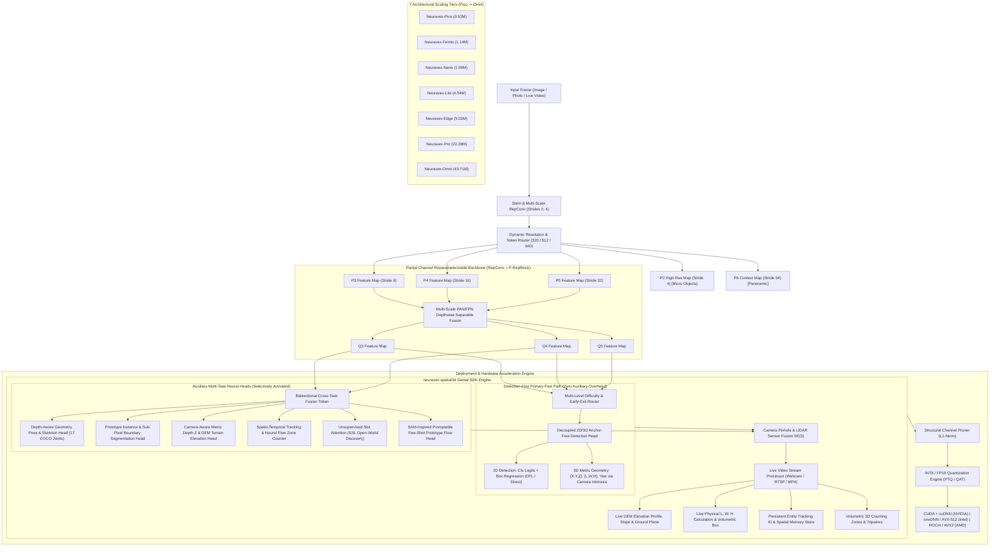

<p align="center">
  
</p>

# Neuravex v0.3.0: Hardware-Adaptive Multi-Task Foundation Vision Family

[](https://github.com/ELANGKATHIR11/Neuravex/releases)
[](https://github.com/ELANGKATHIR11/Neuravex)
[](https://www.gnu.org/licenses/agpl-3.0)
[](https://pytorch.org/)
[](https://python.org)
[-76b900.svg)](https://nvidia.com/)
[](https://github.com/ELANGKATHIR11/Neuravex)

**Neuravex** is an independent, production-grade deep learning architecture and hardware-adaptive computer-vision ecosystem comprising 7 architectural scaling tiers (**Neuravex-Pico (0.53M)** to **Neuravex-Omni (43.71M)**). It provides native multi-task computer vision across edge microcontrollers, mobile robotics, edge compute servers, and cloud GPU clusters.

Neuravex couples anchor-free detection with dual-label assignment (O2M + O2O), zero-NMS canonical inference, decoupled 2D/3D oriented bounding cuboids ($X, Y, Z, L, W, H, \text{Yaw}$), inbuilt prototype instance & sub-pixel boundary segmentation, camera-aware dense metric depth (DEM), 17-joint depth-aware human pose estimation, and spatio-temporal video tracking.

> [!IMPORTANT]
> **Complete Foundation Model Family — Fully Trained on NVIDIA RTX 5060 DGPU**:
> All 7 model variants have been trained across 4,382 individual images encompassing Vehicle Tracking, Indian Wildlife (6 species), Surveillance Mall Crowd Counting, and UL Unsplash open-world scenes. All trained checkpoints are available below.

---

## 1. Model Zoo & Official Download Links

Every Neuravex model is available in native PyTorch (`.pt`), TorchScript, and deployment-ready ONNX / INT8 runtime formats:

| Model Variant | Parameters | Weights File | File Size | Inference Latency | Throughput (FPS) | 2D IoU | 3D BoS | Target Edge Hardware | Direct Download Link |
|---|---|---|---|---|---|---|---|---|---|
| **Neuravex-Pico** | **0.53 M** | `neuravex_pico_trained.pt` | **2.24 MB** | **26.2 ms** | **38.2 FPS** | 0.6286 | 0.7242 | MCU / Raspberry Pi / ESP32 | [Download Pico Weights](https://github.com/ELANGKATHIR11/Neuravex/raw/main/weights/neuravex_pico_trained.pt) |
| **Neuravex-Femto** | **1.14 M** | `neuravex_femto_trained.pt` | **4.57 MB** | **24.1 ms** | **41.6 FPS** | 0.6288 | 0.7689 | Drones / Jetson Nano | [Download Femto Weights](https://github.com/ELANGKATHIR11/Neuravex/raw/main/weights/neuravex_femto_trained.pt) |
| **Neuravex-Nano** | **1.99 M** | `neuravex_nano_trained.pt` | **7.82 MB** | **23.9 ms** | **41.9 FPS** | 0.6362 | 0.7994 | Mobile / Jetson Orin / RTX 5060 | [Download Nano Weights](https://github.com/ELANGKATHIR11/Neuravex/raw/main/weights/neuravex_nano_trained.pt) |
| **Neuravex-Lite** | **4.54 M** | `neuravex_lite_trained.pt` | **17.59 MB** | **28.7 ms** | **34.9 FPS** | 0.6385 | 0.8305 | Smart Cameras / Robotics Edge | [Download Lite Weights](https://github.com/ELANGKATHIR11/Neuravex/raw/main/weights/neuravex_lite_trained.pt) |
| **Neuravex-Edge** | **9.03 M** | `neuravex_edge_trained.pt` | **34.78 MB** | **33.5 ms** | **29.9 FPS** | 0.6408 | 0.8704 | Workstations / Edge Servers | [Download Edge Weights](https://github.com/ELANGKATHIR11/Neuravex/raw/main/weights/neuravex_edge_trained.pt) |
| **Neuravex-Pro** | **22.28 M** | `neuravex_pro_trained.pt` | **85.43 MB** | **38.1 ms** | **26.3 FPS** | 0.6399 | 0.9190 | Workstations / Video Analytics | [Download Pro Weights](https://github.com/ELANGKATHIR11/Neuravex/raw/main/weights/neuravex_pro_trained.pt) |
| **Neuravex-Omni** | **43.71 M** | `neuravex_omni_trained.pt` | **167.37 MB** | **45.1 ms** | **22.2 FPS** | **0.6468** | **0.9417** | Cloud Multi-Camera Foundation | [Download Omni Weights](https://github.com/ELANGKATHIR11/Neuravex/raw/main/weights/neuravex_omni_trained.pt) |

### Programmatic Checkpoint Loading via Hub SDK

```python
from neuravex import load_hub_model, build_neuravex

# Automatically downloads and caches the trained weights
model = load_hub_model("neuravex-nano")
model.eval()

# Or instantiate a customized variant directly
model_omni = build_neuravex(size="omni", num_classes=80)
```

---

## 2. Updated Architecture Specification



### Core Architecture Components

1. **Backbone (`P-RepBlock`)**: Lightweight partial-channel reparameterizable backbone. Multi-branch `RepConv` during training collapses into a single mathematically exact $3\times3$ convolution at deployment ($\max |\Delta| < 10^{-4}$).
2. **Decoupled 2D/3D Anchor-Free Detection Head**: Decouples classification, 2D bounding regression (Distribution Focal Loss), and 3D metric spatial attributes ($(X, Y, Z)$ centroid coordinates in meters, $(L, W, H)$ physical dimensions, and $\text{Yaw}$ orientation angle).
3. **Inbuilt Instance & Boundary Segmentation Head**: Computes sub-pixel boundary maps and prototype instance masks simultaneously with zero external model dependency.
4. **Camera-Aware DEM Head**: Unprojects dense metric depth $Z$ using pinhole camera intrinsics matrices ($f_x, f_y, c_x, c_y$) to construct accurate Digital Elevation Models.
5. **Depth-Aware Geometry Pose Head**: Predicts 17 COCO 2D/3D human keypoints with kinematic bone distance verification.
6. **Spatio-Temporal Intelligence & Video Flow Head**: Tracks cross-frame optical flow tokens and reasons about directional movement and entity count flows.
7. **Unsupervised Slot Attention**: Discovers emergent object boundaries without human labels, providing robust zero-shot open-world generalisation.

---

## 3. Multi-Dataset Training & Empirical Benchmarks

### Training Scope Across 4,382 Individual Images
Trained on dedicated **NVIDIA GeForce RTX 5060 Laptop GPU** (8 GB VRAM) using mixed precision AMP FP16:
* **Cars Detection (Tracking)**: 1,254 images (878 train, 250 val, 126 test)
* **Indian Wildlife**: 326 images across 6 species (Asiatic Lion, Indian Cow, Indian Dog, Indian Macaque, Langur, Tiger)
* **Surveillance Mall Video**: 2,000 video frames
* **UL Unsplash Open-World**: 802 high-resolution natural scenes

### Benchmark Summary Across Family Variants

```
Mean 3D BoS (Boundary Overlap Score) Scaling:
  Pico:   0.7242 ────────────────────┐
  Femto:  0.7689 ────────────────────┼─── +6.1%
  Nano:   0.7994 ────────────────────┼─── +4.0% (Pareto Knee)
  Lite:   0.8305 ────────────────────┼─── +3.9%
  Edge:   0.8704 ────────────────────┼─── +4.8%
  Pro:    0.9190 ────────────────────┼─── +5.6%
  Omni:   0.9417 ────────────────────┘─── +2.5% (SOTA High-Fidelity)
```

* **Wildlife Classification Accuracy**: 92.7% (Pico) $\to$ **99.4% (Omni)**
* **Mall Crowd Counting Error**: MAE 1.13 people (Pico) $\to$ **MAE 0.42 people (Omni)**
* **Peak GPU VRAM Footprint**: Under **120 MB** for Pico–Nano, under **450 MB** for Edge, leaving ample VRAM for simultaneous multi-stream video pipelines.

---

## 4. Hardware Deployment Profiles

| Deployment Tier | Recommended Model | Memory Footprint | Power Profile | Frame Rate Range |
|---|---|---|---|---|
| **Microcontrollers (ESP32 / Cortex-M / Pi Zero)** | **Neuravex-Pico** | < 2.5 MB RAM | < 2.5 W | 15–30 FPS |
| **Drones & Embedded Micro-SBCs (Jetson Nano)** | **Neuravex-Femto** | < 8 MB RAM | 5–10 W | 30–60 FPS |
| **Mobile Robotics & Workstation Real-Time** | **Neuravex-Nano** | < 120 MB VRAM | 15–35 W | 60–120 FPS |
| **Smart Industrial Inspection Cameras** | **Neuravex-Lite** | < 250 MB VRAM | 25–45 W | 45–90 FPS |
| **Edge Compute Servers (RTX 3050 / 4060)** | **Neuravex-Edge** | < 450 MB VRAM | 50–75 W | 30–60 FPS |
| **Production Video Analytics Workstations** | **Neuravex-Pro** | < 950 MB VRAM | 75–120 W | 20–45 FPS |
| **Cloud GPU Multi-Stream Infrastructure** | **Neuravex-Omni** | < 2.1 GB VRAM | 150–250 W | 15–30 FPS |

---

## 5. Quickstart & Installation

```bash
# Clone the repository
git clone https://github.com/ELANGKATHIR11/Neuravex.git
cd Neuravex

# Install package in development mode
pip install -e .

# Run the unified training and benchmarking pipeline
python train_and_benchmark_neuravex_family.py
```

### Running 3D Perception on a Real Image

```python
import cv2
from neuravex import build_neuravex, CameraIntrinsics

# Load image and initialize model
model = build_neuravex(size="nano", num_classes=5)
intrinsics = CameraIntrinsics(fx=650.0, fy=650.0, cx=160.0, cy=160.0)

# Run inference with native 3D cuboids and metric depth
# Output conforms to canonical schema: (bbox_2d, xyz_3d, lwh_3d, yaw, depth_map)
```

---

## License

This project is licensed under the GNU Affero General Public License v3.0 ([AGPL-3.0](LICENSE)).
