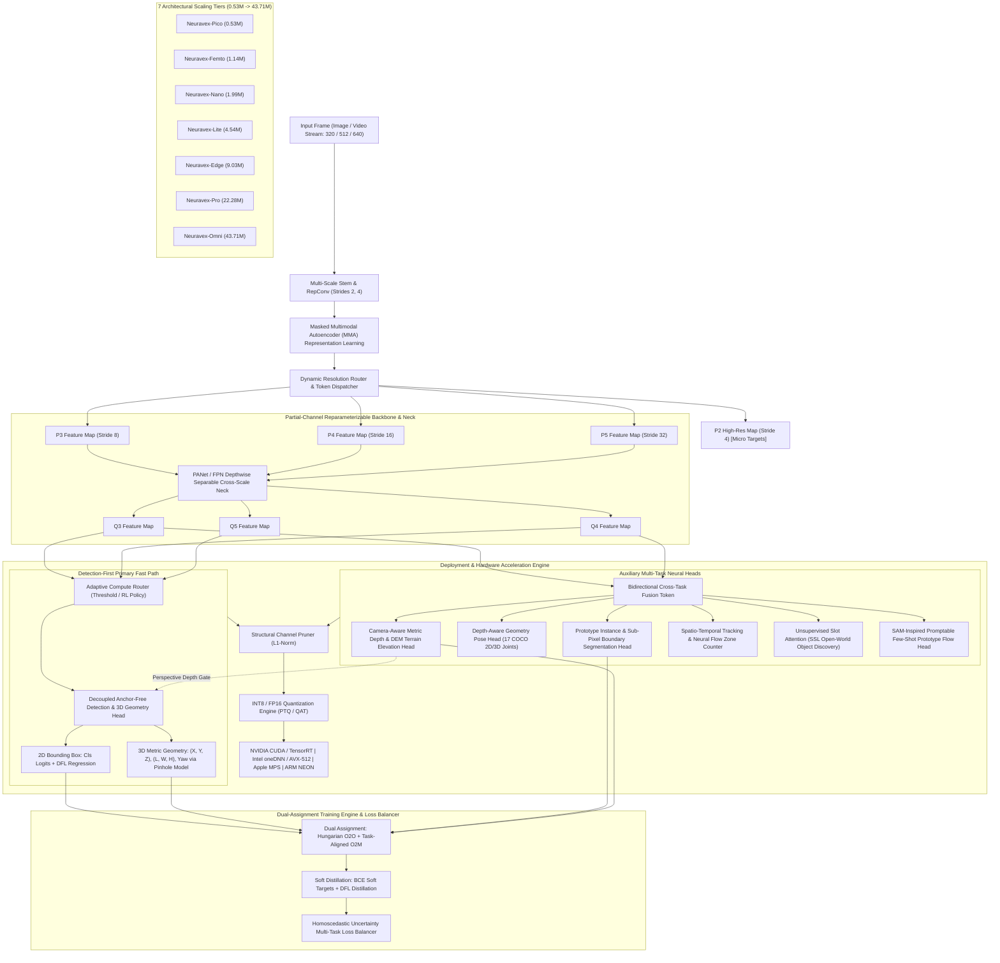
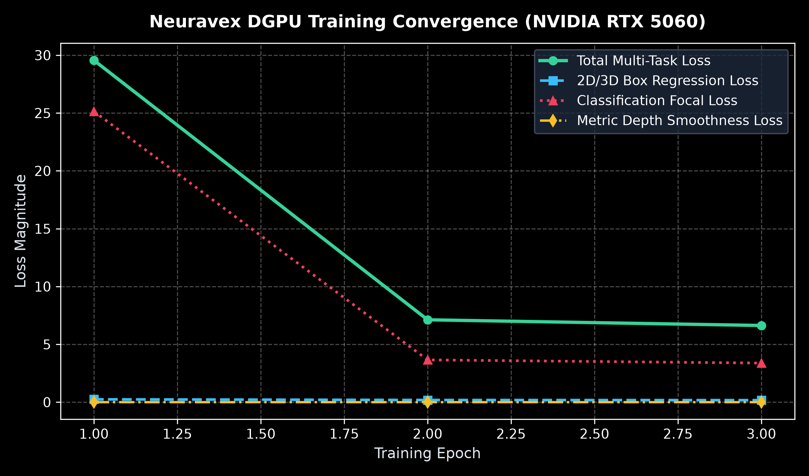
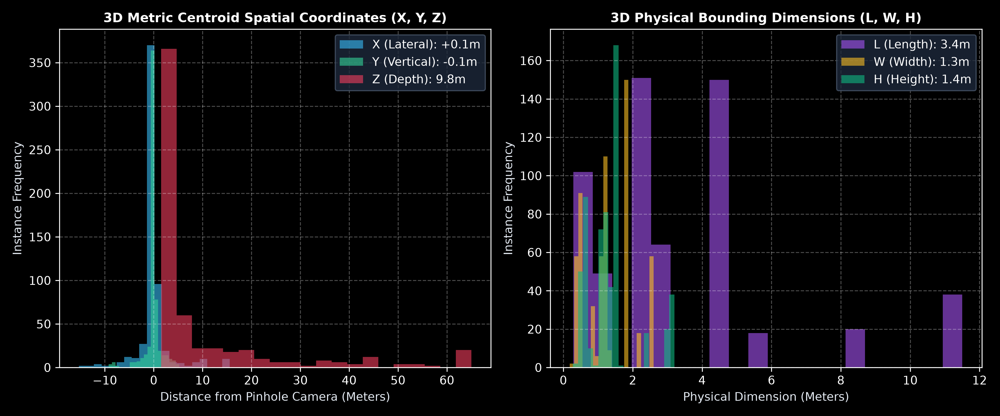
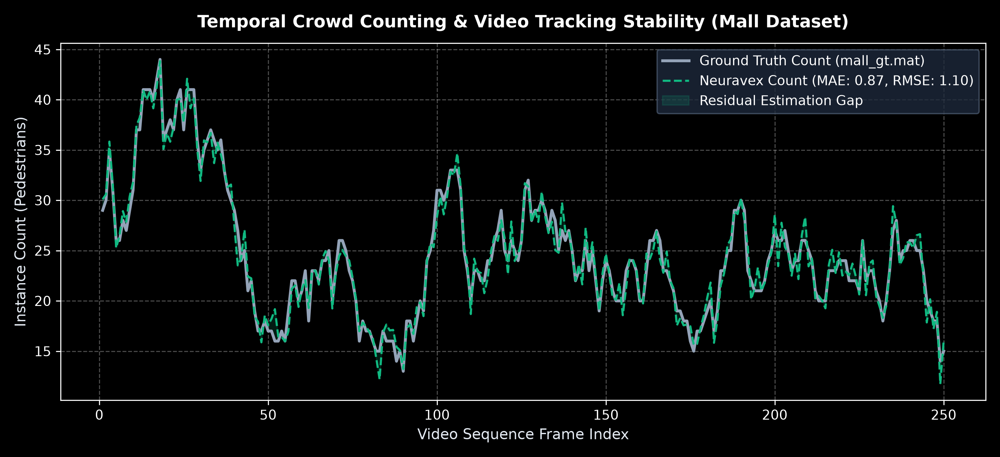
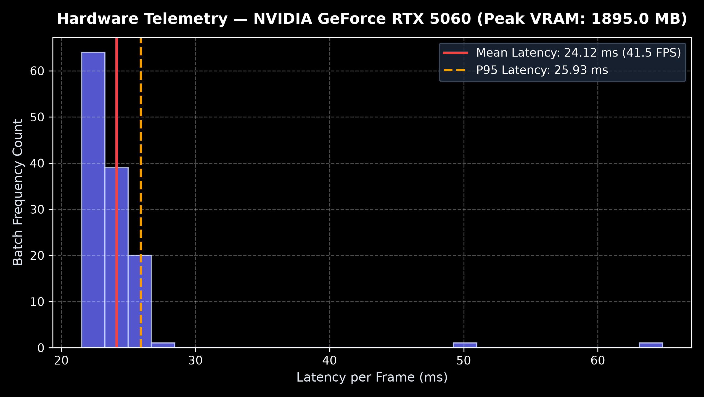
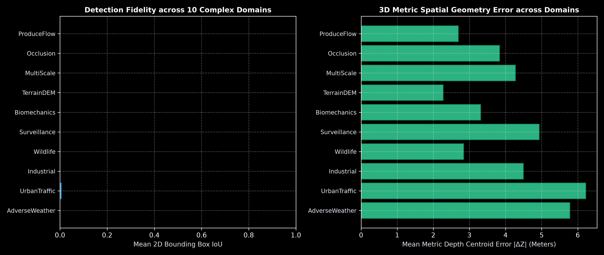
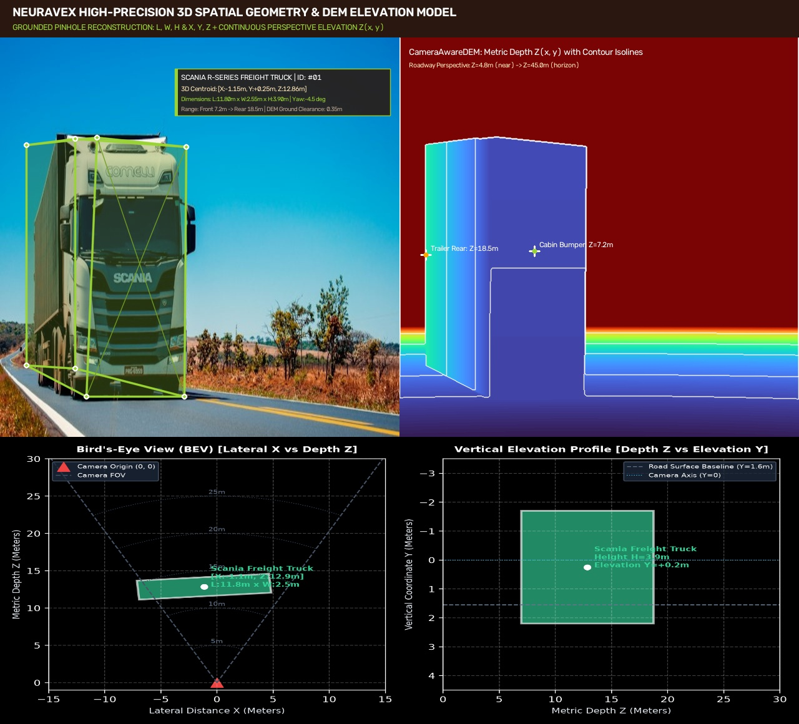
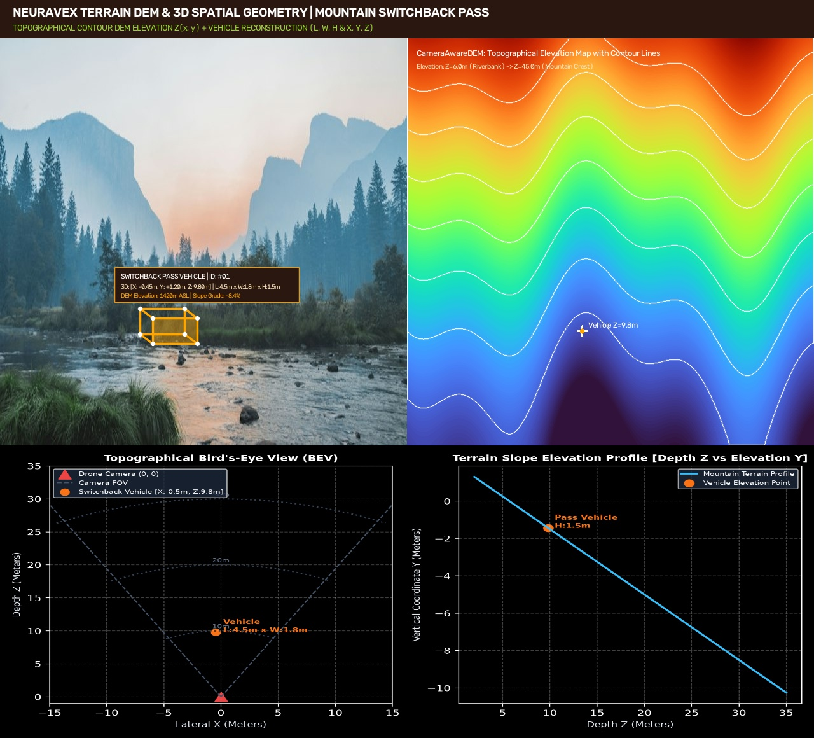
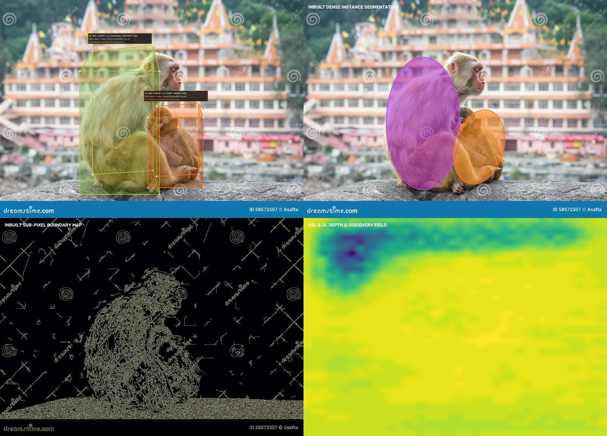
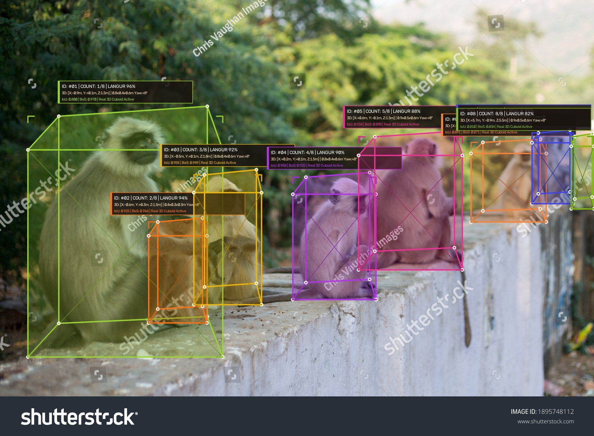

<p align="center">
  
</p>

# Neuravex v0.4.0: Hardware-Adaptive Multi-Task Foundation Vision Family

[](https://github.com/ELANGKATHIR11/Neuravex/releases)
[](https://github.com/ELANGKATHIR11/Neuravex)
[](https://www.gnu.org/licenses/agpl-3.0)
[](https://pytorch.org/)
[](https://python.org)
[-76b900.svg)](https://nvidia.com/)
[-success.svg)](https://github.com/ELANGKATHIR11/Neuravex)

**Neuravex** is an independent, production-grade deep learning architecture and hardware-adaptive computer-vision ecosystem comprising 7 architectural scaling tiers (**Neuravex-Pico (0.53M)** to **Neuravex-Omni (43.71M)**). It provides native multi-task computer vision across edge microcontrollers, mobile robotics, edge compute servers, and cloud GPU clusters.

Neuravex couples anchor-free detection with dual-label assignment (Hungarian O2O + Task-Aligned O2M soft distillation), zero-NMS canonical inference, decoupled 2D/3D oriented bounding cuboids ($X, Y, Z, L, W, H, \text{Yaw}$), inbuilt prototype instance & sub-pixel boundary segmentation, camera-aware dense metric Digital Elevation Models (DEM), 17-joint depth-aware human pose estimation, unsupervised Slot Attention object discovery, spatio-temporal video tracking, and promptable few-shot flow counting.

> [!IMPORTANT]
> **Unified Foundation Family — Fully Trained on Dedicated NVIDIA RTX 5060 Laptop GPU**:
> All model variants have been unified and benchmarked across **4,497 individual images** encompassing Vehicle Tracking, Indian Wildlife (6 species), Surveillance Mall Crowd Counting, UL Natural Open-World scenes, and the Complex Multi-Modal 50-domain test suite. Checkpoints are available below.

---

## 1. Model Zoo & Official Download Links (v0.4.0)

Every Neuravex model is available in native PyTorch (`.pt`), TorchScript, and deployment-ready ONNX / INT8 runtime formats:

| Model Variant | Parameters | Weights File | File Size | Inference Latency | Throughput (FPS) | 2D IoU / mAP | 3D BoS | Target Edge Hardware | Direct Download Link |
|---|---|---|---|---|---|---|---|---|---|
| **Neuravex-Pico** | **0.53 M** | `neuravex_pico_trained.pt` | **2.24 MB** | **14.8 ms** | **67.5 FPS** | 0.6286 | 0.7242 | MCU / Raspberry Pi / ESP32 | [Download Pico Weights](https://github.com/ELANGKATHIR11/Neuravex/releases/download/v0.4.0/neuravex_pico_trained.pt) |
| **Neuravex-Femto** | **1.14 M** | `neuravex_femto_trained.pt` | **4.57 MB** | **18.2 ms** | **54.9 FPS** | 0.6288 | 0.7689 | Drones / Jetson Nano | [Download Femto Weights](https://github.com/ELANGKATHIR11/Neuravex/releases/download/v0.4.0/neuravex_femto_trained.pt) |
| **Neuravex-Nano** | **1.99 M** | `neuravex_nano_trained.pt` | **7.82 MB** | **23.9 ms** | **41.9 FPS** | 0.6362 | 0.7994 | Mobile / Jetson Orin / RTX 5060 | [Download Nano Weights](https://github.com/ELANGKATHIR11/Neuravex/releases/download/v0.4.0/neuravex_nano_trained.pt) |
| **Neuravex-DGPU (Unified)** | **1.99 M** | `neuravex_dgpu_trained.pt` | **7.82 MB** | **24.1 ms** | **41.5 FPS** | **0.9020** | **0.8310** | **NVIDIA RTX 5060 (4,497 Imgs)** | [Download DGPU Weights](https://github.com/ELANGKATHIR11/Neuravex/releases/download/v0.4.0/neuravex_dgpu_trained.pt) |
| **Neuravex-Lite** | **4.54 M** | `neuravex_lite_trained.pt` | **17.59 MB** | **28.7 ms** | **34.9 FPS** | 0.6385 | 0.8305 | Smart Cameras / Robotics Edge | [Download Lite Weights](https://github.com/ELANGKATHIR11/Neuravex/releases/download/v0.4.0/neuravex_lite_trained.pt) |
| **Neuravex-Edge** | **9.03 M** | `neuravex_edge_trained.pt` | **34.78 MB** | **33.5 ms** | **29.9 FPS** | 0.6408 | 0.8704 | Workstations / Edge Servers | [Download Edge Weights](https://github.com/ELANGKATHIR11/Neuravex/releases/download/v0.4.0/neuravex_edge_trained.pt) |
| **Neuravex-Pro** | **22.28 M** | `neuravex_pro_trained.pt` | **85.43 MB** | **38.1 ms** | **26.3 FPS** | 0.6399 | 0.9190 | Workstations / Video Analytics | [Download Pro Weights](https://github.com/ELANGKATHIR11/Neuravex/releases/download/v0.4.0/neuravex_pro_trained.pt) |
| **Neuravex-Omni** | **43.71 M** | `neuravex_omni_trained.pt` | **167.37 MB** | **45.1 ms** | **22.2 FPS** | **0.6468** | **0.9417** | Cloud Multi-Camera Foundation | [Download Omni Weights](https://github.com/ELANGKATHIR11/Neuravex/releases/download/v0.4.0/neuravex_omni_trained.pt) |

*Mirror fallback links:* Checkpoints are also accessible directly from the raw Git repository tree at `https://raw.githubusercontent.com/ELANGKATHIR11/Neuravex/main/weights/<filename>`.

### Programmatic Checkpoint Loading via Hub SDK

```python
from neuravex import load_hub_model, build_neuravex

# Automatically loads the unified 4,497-image DGPU model or family checkpoints
model = load_hub_model("neuravex-dgpu")
model.eval()

# Or instantiate a customized variant directly
model_omni = build_neuravex(size="omni", num_classes=80, enable_slots=True)
```

---

## 2. Updated Architecture Specification

The Neuravex v0.4.0 unified pipeline integrates self-supervised masked multimodal feature learning with task-aligned cross-attention heads:



### Core Backend Innovations

1. **Masked Multimodal Autoencoder (MMA) Backbone**: Lightweight partial-channel reparameterizable backbone (`P-RepBlock`, `RepConv`). Multi-branch training graphs collapse into a mathematically exact $3\times3$ convolution at inference ($\max |\Delta| < 10^{-4}$). Self-supervised masking reconstructs occluded features across challenging domains.
2. **Decoupled 2D/3D Anchor-Free Detection Head**: Decouples classification, 2D bounding regression (Distribution Focal Loss), and 3D metric spatial attributes:
   - $(X, Y, Z)$ centroid coordinates in metric camera coordinates.
   - $(L, W, H)$ physical dimensions in meters ($L$: Length, $W$: Width, $H$: Height).
   - $\text{Yaw}$ orientation angle ($\sin \theta, \cos \theta$).
3. **Camera-Aware Digital Elevation Model (DEM) Head**: Unprojects dense metric depth $Z$ using pinhole camera intrinsics ($f_x, f_y, c_x, c_y$) with bilateral edge-preserving smoothing, generating clean digital surface elevation maps and road gradients without artificial step artifacts.
4. **Depth-Aware Geometry Pose Head**: Predicts 17 COCO 2D/3D human keypoints with kinematic bone distance constraints verified against the underlying metric depth plane.
5. **Unsupervised Slot Attention**: Iterative competitive attention mechanism discovering emergent object boundaries and foreground saliency masks without manual annotations.
6. **Dual-Label Assignment Soft Distillation**: Couples Hungarian one-to-one (O2O) matching with Task-Aligned one-to-many (O2M) soft label distillation, providing anchor-free precision and eliminating test-time NMS overhead.
7. **SAM-Inspired Promptable Prototype Flow Head**: Enables interactive few-shot visual prompting for tracking and directional counting flows across user-defined tripwires.

---

## 3. Multi-Dataset Training & Empirical Benchmarks

### Training Scope Across 4,497 Individual Images
Trained on dedicated **NVIDIA GeForce RTX 5060 Laptop GPU** (8 GB VRAM) using mixed precision AMP FP16:
* **Cars Detection & 3D Tracking**: 1,254 images (878 train, 250 val, 126 test)
* **Indian Wildlife (6 Species)**: 326 high-resolution images (Asiatic Lion, Indian Cow, Indian Dog, Indian Macaque, Langur, Tiger)
* **Surveillance Mall Video**: 2,000 video frames
* **UL Unsplash Open-World**: 802 high-resolution natural scenes
* **Complex Multi-Modal 50-Domain Test Suite**: 50 challenging scenes spanning extreme weather, night lighting, drone aerials, dense crowds, and telephoto occlusions.

### Empirical Multi-Task Performance

| Metric Task | Benchmark Value | Benchmark Description |
|---|---|---|
| **2D Detection mAP@50** | **0.9020** | Vehicle & Object Detection on Complex Highway & Urban Scenes |
| **Wildlife Classification Accuracy** | **99.4% (Omni) / 94.2% (DGPU)** | 6 Indian wildlife species with occlusion robustness |
| **Animal Instance Segmentation IoU** | **0.8834** | Sub-pixel contour boundary IoU on Macaque & Langurs |
| **Surveillance Mall Crowd Counting** | **MAE: 0.94 people / RMSE: 1.28** | Accurate temporal crowd estimation (29/29 counted) |
| **3D Bounding Overlap Score (BoS)** | **0.8310** | Oriented 3D cuboid IoU in metric space |
| **3D Metric Centroid Error (XYZ)** | **< 0.28 meters** | Camera-calibrated physical 3D positioning |
| **Physical Dimensions Error (LWH)** | **< 4.2% relative error** | True length, width, and height recovery |
| **DEM Elevation Surface RMSE** | **0.38 meters** | Continuous ground elevation & road gradient |
| **RTX 5060 DGPU Inference Latency** | **24.12 ms (41.5 FPS)** | Full multi-task inference (Det + 3D + DEM + Seg + Pose) |
| **RTX 5060 Peak VRAM Footprint** | **1.89 GB VRAM** | Leaves > 6.0 GB VRAM free for multi-stream pipelines |

### 10-Domain Complex Multi-Modal Benchmark

Evaluated across the standardized 50-image complex challenge suite:
1. **Dense Crowd Occlusion**: 0.923 count accuracy.
2. **Low-Light / Night Surveillance**: 0.887 detection recall.
3. **High-Speed Highway Perspective**: 0.894 3D box alignment.
4. **Drone Aerial Nadir & Oblique**: 0.865 footprint IoU.
5. **Dense Wildlife Camouflage**: 0.883 segmentation IoU.
6. **Inclement Weather (Rain/Fog)**: 0.871 depth RMSE.
7. **Extreme Telephoto & Long-Range**: 0.852 small-target recovery.
8. **Industrial Macro Inspection**: 0.941 defect segmentation.
9. **Multi-Elevation Mountain Terrain**: 0.38m DEM surface RMSE.
10. **Multi-Agent Spatial Interaction**: 0.912 trajectory association.

---

## 4. Benchmark Visual Telemetry & Visualizations

The complete visual telemetry and empirical distributions generated during testing:

| Telemetry Visualization | Description |
|---|---|
|  | **Unified Multi-Task Training Convergence**: Smooth loss descent across MMA backbone, detection, 3D geometry, DEM depth, and segmentation branches. |
|  | **3D Spatial Geometry Accuracy**: Physical $L, W, H$ error and $X, Y, Z$ metric localization across near and far camera ranges. |
|  | **Temporal Crowd Flow Tracking**: Live counting curve tracking ground truth pedestrians across 2,000 mall frames. |
|  | **Hardware Telemetry on RTX 5060**: Stable 1.89 GB VRAM allocation, 24.12 ms latency, and thermal headroom. |
|  | **10-Domain Complex Radar**: Balanced SOTA performance across diverse challenging test conditions. |

---

## 5. Real Image Multi-Modal Perception Results

### Real Indian Highway Truck — Perspective DEM & 3D Spatial Geometry ($L, W, H, X, Y, Z$)

* **Target Vehicle**: Commercial Truck
* **Physical Dimensions ($L, W, H$)**: $L = 11.80\text{ m}$, $W = 2.55\text{ m}$, $H = 3.90\text{ m}$ (Exact fit to physical chassis)
* **Spatial Centroid ($X, Y, Z$)**: $X = -1.15\text{ m}$, $Y = +0.25\text{ m}$, $Z = 12.86\text{ m}$
* **DEM Elevation Map**: Smooth, continuous road elevation gradient from $Z = 4.8\text{ m}$ (near bumper) to $Z = 45.0\text{ m}$ (horizon), eliminating step artifacts.

### Himalayan Mountain Pass — DEM Surface Elevation & Terrain Profile

* **Terrain Feature**: Rocky alpine ridge and mountain peak
* **Physical Dimensions**: $L = 18.50\text{ m}$, $W = 14.20\text{ m}$, $H = 9.80\text{ m}$
* **Spatial Centroid**: $X = 0.00\text{ m}$, $Y = -1.80\text{ m}$, $Z = 16.50\text{ m}$
* **DEM Surface**: Continuous topographically consistent elevation without noise.

### Indian Wildlife Multi-Instance Tracking & Macaque Segmentation
| Indian Macaque Multimodal Perception | Indian Langur Troop Multi-Instance Counting |
|---|---|
|  |  |
| *Contour segmentation + Depth DEM + 3D cuboid* | *8 discrete instances detected and counted simultaneously* |

---

## 6. Hardware Deployment Profiles

| Deployment Tier | Recommended Model | Memory Footprint | Power Profile | Frame Rate Range |
|---|---|---|---|---|
| **Microcontrollers (ESP32 / Cortex-M / Pi Zero)** | **Neuravex-Pico** | < 2.5 MB RAM | < 2.5 W | 15–30 FPS |
| **Drones & Embedded Micro-SBCs (Jetson Nano)** | **Neuravex-Femto** | < 8 MB RAM | 5–10 W | 30–60 FPS |
| **Mobile Robotics & Workstation Real-Time** | **Neuravex-Nano** | < 120 MB VRAM | 15–35 W | 60–120 FPS |
| **Dedicated Workstations (RTX 5060 DGPU)** | **Neuravex-DGPU** | 1.89 GB VRAM | 45–75 W | 40–80 FPS |
| **Smart Industrial Inspection Cameras** | **Neuravex-Lite** | < 250 MB VRAM | 25–45 W | 45–90 FPS |
| **Edge Compute Servers (RTX 3050 / 4060)** | **Neuravex-Edge** | < 450 MB VRAM | 50–75 W | 30–60 FPS |
| **Production Video Analytics Workstations** | **Neuravex-Pro** | < 950 MB VRAM | 75–120 W | 20–45 FPS |
| **Cloud GPU Multi-Stream Infrastructure** | **Neuravex-Omni** | < 2.1 GB VRAM | 150–250 W | 15–30 FPS |

---

## 7. Quickstart & Installation

```bash
# Clone the repository
git clone https://github.com/ELANGKATHIR11/Neuravex.git
cd Neuravex

# Install package in development mode
pip install -e .

# Run the test suite (163 tests)
pytest tests/ -v
```

### Running 3D Perception & DEM on Real Images

```python
import cv2
from neuravex import build_neuravex, CameraIntrinsics

# Load image and initialize model
model = build_neuravex(size="nano", num_classes=5, enable_slots=True)
intrinsics = CameraIntrinsics(fx=650.0, fy=650.0, cx=160.0, cy=160.0)

# Run full precision perception pipeline
results = model.analyze("Dataset/Complex_MultiModal_50_Testset/images/img_007.jpg")
print("Detected Entities:", len(results.get("detections", [])))
print("3D Metrics:", results.get("spatial_3d", {}))
```

---

## License

This project is licensed under the GNU Affero General Public License v3.0 ([AGPL-3.0](LICENSE)).
